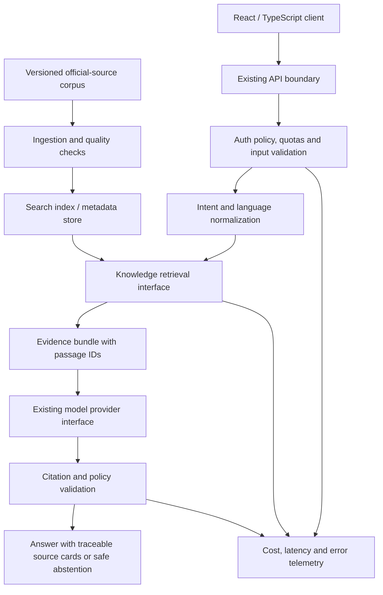

# EL-Rouji Algeria-Centric Engine: Architecture and Delivery Roadmap

**Status:** Proposal and execution plan — not an implementation claim  
**Rechecked:** 25 October 2026  
**Repository:** [looloofy69-sketch/EL-Rouji](https://github.com/looloofy69-sketch/EL-Rouji)  
**Reviewed main commit:** `e08fbc8fea12b37cd013f5f09a1a7d51e8361299)

This document consolidates the Algeria-focused capability proposal into a sequenced, testable engineering plan. It distinguishes verified repository facts, candidate technologies, decisions still requiring evidence, and work that has not been implemented.

## 1. Executive decision

Build EL-Rouji's Algeria-specific advantage through **verified local knowledge, reliable multilingual retrieval, and low-bandwidth behavior** before replacing the existing stack or training a new model.

The first new domain capability should be a narrow, source-grounded Legal and Administrative Knowledge pilot. It is gated behind verification of the current public API's abuse controls and the live deployment state. Begin with an offline corpus, transparent metadata, and a small benchmark; do not expose legal RAG to public users until the evidence, authorization, cost, and release gates below pass.

**No new runtime, database, model, or hosted service is selected by this document.** PostgreSQL/pgvector, ONNX Runtime Web, WebAssembly, LoRA/QLoRA, custom tokenizers, OCR, voice, OpenStreetMap, and isolated code execution remain candidates pending compatibility, privacy, cost, and quality tests.

## 2. Recheck of repository and live-state evidence

The following was observed from the GitHub repository and its Actions run history on 25 October 2026.

| Item | Rechecked state | Consequence |
|---|---|---|
| Repository/default branch | Public repository; default branch `main`; write permission is available to the connected GitHub identity | Documentation can be prepared on a branch and reviewed through a PR |
| Main HEAD | `e08fbc8fea12b37cd013f5f09a1a7d51e8361299` | Roadmap baseline is pinned to an exact commit |
| Latest main CI run checked | [Run #94](https://github.com/looloofy69-sketch/EL-Rouji/actions/runs/40099475237), succeeded on the reviewed main SHA | Locked install, dependency checks, URL-safety regression tests, production audit, typecheck and CI-only frontend build passed |
| Full-tree npm audit | Run #94 reported **3 moderate, 0 high and 0 critical** findings | The full dependency tree is not audit-free. The affected entries are documented in `docs/DEPENDENCY_AUDIT.md` |
| Production-only audit | `npm audit --omit=dev --audit-level=low` found 0 vulnerabilities in run #94 | This is a production-dependency result, not a complete application security audit |
| Open issues | [#9](https://github.com/looloofy69-sketch/EL-Rouji/issues/9) tracks development-tool advisories and AppDeploy compatibility; [#13](https://github.com/looloofy69-sketch/EL-Rouji/issues/13) tracks public endpoint abuse controls and URL-fetch protections | Both remain gates for safe release and expansion |
| Open PRs | #4 TypeScript 7, #5 lucide-react 1.x, #6 React plugin 6.x, #7 Vite 8; all are open Dependabot changes | Review these as compatibility upgrades; major-version labels are not evidence that they are ready to merge |
| Release | The GitHub Releases endpoint returned no releases; current documentation says no release tag exists | Do not represent the product as release-ready based on CI alone |
| Source stack | React, TypeScript, Vite, Tailwind CSS 3, AppDeploy backend/client SDK; current source has a CI-only shim for local build validation | Preserve the current host-compatible stack until there is a tested reason to migrate |
| Source/live discrepancy | GitHub main rejects direct HTTP(S) research-page URLs before fetching. The last documented verified AppDeploy snapshot is still `1792755107550`; no hosted regression test after the source guard was confirmed | Do **not** claim this source mitigation is live. Verify AppDeploy backend validation, deploy under the approved workflow, and test the live behavior before claiming it is active |

The successful CI run used a **build-only AppDeploy SDK shim** for source verification. It does not prove hosted authentication, AI requests, account isolation, secrets, retrieval, or deployment behavior. Never deploy the output produced with `EL_ROUJI_CI_BUILD=1`.

## 3. Product and architecture principles

1. **Evidence before model complexity.** Retrieval, primary-source quality, language handling and citations should be measurable before fine-tuning or a custom tokenizer is considered.
2. **Keep the current stack until evidence supports change.** Do not rewrite to Next.js/Go/Flutter or introduce Kubernetes merely because they appear in a candidate stack.
3. **Separate public knowledge from private conversation data.** Public legal documents may be cached by document version; user prompts, account history and private uploads must not enter shared caches or training corpora by default.
4. **Treat all retrieved content as untrusted input.** Documents are evidence, never instructions. The model must not follow embedded prompts in a legal page or uploaded file.
5. **Citations must be verifiable.** A source card alone is not sufficient: answer claims must map to the actual retrieved passage and its publication/effective metadata.
6. **Fail safely.** When source coverage is inadequate, the current legal text cannot be confirmed, or sources conflict, say so and abstain from a definitive answer.
7. **Optimize for measured Algerian usage.** Measure performance across representative networks, low-end Android devices, Arabic right-to-left text, French, Arabic script Darija, Latin-script Darija and code-switching.
8. **Feature labels follow evidence.** A capability is not “implemented” until code, tests, platform compatibility and user-facing behavior are verified.

## 4. Current baseline versus proposed target

### Verified baseline

- Current UI modes: Assistant, Research, Writing, Study, Coding and Planning.
- Supported interface languages: English, French and Arabic, with Algerian Darija behavior supported by the system prompt where appropriate.
- Backend routes documented in source: health, chat, research, image analysis, text-document analysis, and authenticated conversation synchronization.
- Current file flow supports PNG, JPEG, WebP, TXT, MD, CSV and JSON. PDF and Office document parsing are not part of the existing upload flow.
- Research search depends on server-side `TAVILY_API_KEY`. Configuring a secret does not prove that live provider calls work.
- Voice services, document OCR, legal RAG, a public vector database, local ONNX inference, a full code sandbox, LSP, OSM routing, and payment-gateway simulation are **not confirmed implemented capabilities**.

### Proposed logical architecture

This diagram is a design target, not a description of deployed infrastructure. Provider, database, embedding model, model hosting, and index are deliberately abstracted. The existing AppDeploy boundary must be verified before any component is attached to it.

## 5. Delivery sequence and exit gates

### Phase 0 — Verify safety and platform constraints

**Do not add public RAG endpoints before this phase is resolved.**

- Resolve issue #13's questions: whether chat, research and analysis are intentionally anonymous; which platform/gateway quotas, concurrency limits and cost caps apply; and how abuse is detected.
- Run bounded tests of public endpoints and provider error handling without exposing secrets or generating uncontrolled spend.
- Confirm the URL-rejection safeguard compiles through the real AppDeploy backend path. Test direct URL rejection and query-based search in a controlled deployment, and check the localized English/French/Arabic UI guidance.
- Confirm the actual hosted version/commit mapping, rollback path, and current research-secret behavior.
- Continue issue #9's full-tree dependency review. Record the owner's explicit risk decision; do not convert a clean production-only npm audit into a claim of complete security.
- Review open Dependabot PRs individually. Run locked install, typecheck, build and hosted/platform compatibility checks for major upgrades; avoid bundling unrelated upgrades into the RAG work.

**Exit criteria:** documented live runtime state; endpoint authorization/anonymous-use policy; measured usage limits; successful controlled hosted smoke tests; source/live discrepancy recorded and resolved or explicitly retained as a blocker.

### Phase 1 — Build a lawful, versioned source corpus and evaluation set

Start with a narrow public-information scope, such as selected official business-administration and tax topics, rather than trying to index all Algerian law at once.

- Prefer official primary sources, beginning with the [Journal Officiel / Secrétariat Général du Gouvernement portal](https://www.joradp.dz/HFR/Accueil.htm). Add other official sources only when their authority, update process and terms can be verified.
- Record source provenance, document version, publication and effective dates when available, amendments/repeals, language, retrieval date, checksum, source URL, parsing quality, and reuse/license constraints.
- Track documents that supersede earlier texts. Do not treat the latest ingestion timestamp as proof that the legal rule is currently in force.
- Create a hand-reviewed evaluation set across Arabic, French, Arabic-script Darija, Latin-script Darija and code-switching. Include ambiguity, outdated-law traps, missing-source cases, conflicting sources and requests outside the corpus.
- Do not use private user conversations as training/evaluation data without a separate explicit, informed opt-in, minimization, retention policy and review.

**Proposed passage metadata contract:**

| Field | Purpose |
|---|---|
| `source_id`, `document_id`, `passage_id` | Stable identifiers that citations and tests can resolve |
| `source_url`, `publisher`, `document_title` | Provenance and user-verifiable source link |
| `document_type`, `topic`, `jurisdiction` | Filtering and scoped retrieval |
| `publication_date`, `effective_from`, `effective_to`, `status` | Time-aware interpretation; preserve unknown values as unknown |
| `article_or_section`, `page_or_location` | Find the exact legal passage |
| `language`, `script`, `text` | Multilingual indexing and quotation |
| `retrieved_at`, `checksum`, `parser_version` | Reproducibility, update detection and provenance |
| `rights_or_reuse_note`, `quality_flags` | Content-use controls and parsing review |

Do not invent missing legal dates or silently infer repeal status. Use explicit “unknown / needs verification” values.

### Phase 2 — Offline RAG proof of concept

- Build ingestion and retrieval tests outside the public production route first.
- Define a provider-agnostic retrieval interface: ingest/update, search, fetch passage by ID, inspect source status, and report index version.
- Begin with a reproducible baseline: lexical search plus a separately evaluated embedding/retrieval option. Test Arabic/French normalization and Darija variants instead of assuming a single tokenizer works equally well across scripts.
- Generate a bounded evidence bundle with passage IDs, source metadata and text limits; never pass the entire corpus to the model.
- Keep citations bound to retrieved passage IDs. Validate them in code before rendering; reject invented IDs or URLs.
- Apply freshness and status filters where source metadata supports them. If the source status cannot be established, disclose the uncertainty.
- Compare candidate stores after the host is understood. PostgreSQL + pgvector is a candidate if supported and operationally suitable; Milvus, Pinecone or another managed vector store are alternatives, not preselected dependencies.

**Exit criteria:** a reproducible offline run; cited answers map to real indexed passages; tests cover unsupported questions, stale texts, injection-like source text and retrieval failures; latency, cost and error baselines recorded.

### Phase 3 — Controlled Legal/Administrative pilot

- Keep the first release small and opt-in, with a visible description of corpus coverage and last successful source refresh.
- Return direct primary-source links, document/article identity, and effective-date information when known.
- Distinguish source quotation, general explanation and legal interpretation. Do not claim to replace an Algerian lawyer, accountant or competent public authority.
- Abstain when the source corpus does not support the answer or legal currency is uncertain.
- Record only minimized operational metrics. Never log provider keys or store full prompts by default as debugging telemetry.
- Add a corpus-refresh job only after a source change detector, parse validation, rollback/version pinning and stale-source alerts have been tested.

**Exit criteria:** reviewable pilot transcript tests; no fabricated source references in the curated evaluation set; safe abstentions; documented limitations, retention, operator controls and rollback procedure.

### Phase 4 — Low-bandwidth and edge improvements

- Establish current network-transfer, time-to-first-token, total latency, retry and bundle-size baselines before optimization.
- Use bounded local operations first: validation, simple parsing, compression where appropriate, and deterministic helpers that can safely run in the browser.
- Treat WebAssembly as a runtime option for selected logic, not a way to move the full model into the browser by default.
- Evaluate ONNX Runtime Web only for a specific small model or task. Benchmark WASM/CPU and optional GPU execution on representative Android browsers. Browser, operator and device compatibility must be checked before promising offline inference.
- Cache versioned **public** source passages and static assets with invalidation rules. Do not put account-specific responses into shared caches.
- Use a PWA only after installability, offline behavior, privacy boundaries, update integrity and mobile UX have test coverage.
- Consider local or regional Algerian hosting only after measuring actual latency from representative Algerian networks and verifying host availability, data location, backups, uptime, security responsibilities and costs. Do not assume any named ISP/cloud provider is suitable without current verification.

**Exit criteria:** comparative measurements against the baseline and no privacy/security regression.

### Phase 5 — Darija quality and model adaptation

- First build an evaluation set with consented or appropriately licensed examples and clear labels for meaning, script, language switches and context.
- Track separate failure classes: understanding intent, entity spelling, retrieval mismatch, translation, answer factuality, tone, Arabic RTL rendering, and generation quality.
- Test prompt/instruction changes and retrieval normalization before training.
- Evaluate LoRA/QLoRA adapters only if measured errors remain, training examples are legitimately usable, the base model license permits adaptation/deployment, and a rollbackable evaluation pipeline exists.
- Consider a custom tokenizer only after tokenization waste and semantic failures are demonstrated quantitatively on representative Darija text. New tokenizers can require substantial model training/adaptation and may degrade other languages.
- Never state or imply 100% accuracy. Publish measured limits and confidence/abstention behavior.

**Exit criteria:** versioned training/evaluation provenance; held-out test results across languages/scripts; regression checks for French, Modern Standard Arabic and English; deployment, license and rollback decision.

### Phase 6 — Documents, maps and voice

These are independent capabilities; each requires its own scope, dataset, cost and release gate.

- **OCR/document extraction:** support specific form types with consent, extraction-confidence reporting, field-level provenance and correction UI. Redact or minimize sensitive identity/financial fields where possible. Do not store the original document after the request unless retention is explicitly designed and disclosed.
- **OpenStreetMap:** use an appropriate data/geocoding/routing service, comply with OpenStreetMap attribution and applicable data/tile-use policies, handle stale or missing coverage, and avoid promising completeness for every Algerian locality.
- **Voice STT/TTS:** benchmark Algerian accents and Darija variants in realistic noise. Obtain microphone/recording consent, communicate whether processing is local or remote, and define sample retention/deletion. Voice input should not silently send continuous audio.
- **PDF/Office support:** implement a safe parsing pipeline for each format with file-size, decompression, malformed-file and resource limits. Existing UI support for TXT/MD/CSV/JSON does not imply PDF/DOCX/XLSX support.

### Phase 7 — Developer tools and payment simulation

- **Code execution:** Pyodide/WASM can support some bounded client-side Python tasks, but must not be treated as a universal security boundary. Any arbitrary server-side execution requires strong isolation, strict CPU/memory/time limits, no host secrets, network denied by default, filesystem constraints, and abuse monitoring. Do not execute user code in the AppDeploy backend process.
- **LSP/project understanding:** treat this as a distinct coding-workspace integration. Require explicit repository/workspace permissions, bounded file access, path traversal protection and clear disclosure of which files are read.
- **API/payment simulator:** create a mock SATIM-style interface only from a documented test contract and fictitious card/payment data. Provide deterministic success, decline, timeout, duplicate callback and malformed-response scenarios. It must be visually and technically separated from real payment processing; no real merchant credentials or card data in tests.
- **Next.js/Go/Flutter/Docker/Kubernetes:** do not migrate the product to these technologies solely because they appear in a proposed stack. First identify a concrete deployment or performance constraint, measure it, prototype the smallest compatible change, and compare total operational burden.

## 6. Security, privacy and abuse controls

Before expanding public model calls or adding retrieval:

- Define per-endpoint anonymous/authenticated access intentionally; verify it at the actual hosted boundary, not only in frontend code.
- Measure and enforce request-size limits, quotas, rate limits, concurrency limits, provider-spend bounds, timeouts and safe retries.
- Ensure authentication/authorization checks use server-side identities and object-level ownership for cloud history. Use synthetic accounts for cross-account tests.
- Keep provider credentials server-side. Never expose keys to client bundles, logs, source control, prompt contexts or retrieved pages.
- Treat search results, official documents, OCR text and user attachments as untrusted text. Defend against prompt injection and cross-context data leakage.
- Make user-data retention, deletion, exports, shared-device history, analytics, cache and training-data policies explicit.
- Test dependency updates and generated artifacts with reproducible builds. CI is a build-quality signal, not an application penetration test or proof of host configuration.
- Keep the source/live deployment boundary visible in README, security docs and release records. Never claim a source fix is live until the deployed version and hosted tests establish it.

## 7. Evaluation and acceptance framework

Create a versioned test suite before public rollout. It should include:

- **Retrieval:** primary-source recall, correct article/section, source freshness, language/script variants, empty-result and conflicting-source behavior.
- **Answer grounding:** every legal factual claim requiring authority is backed by a valid retrieved passage; displayed source IDs/URLs resolve to the same evidence used for generation.
- **Safe abstention:** unsupported/out-of-scope questions and unknown effective dates trigger explicit limits rather than plausible invented law.
- **Robustness:** prompt injection in retrieved text, malformed documents, invalid inputs, timeouts, provider failure, rate limiting and duplicate requests.
- **Language/UX:** Arabic RTL, French, English, Arabic-script and Latin-script Darija, mixed-language questions, keyboard/screen-reader essentials, mobile layout.
- **Performance/cost:** bytes transferred, request count, p50/p95 latency, model/retrieval time, failure/retry rate and cost per successful response where measurable.
- **Privacy/security:** anonymous access policy, account isolation, no key leakage, deletion semantics, cache separation and bounded usage.
- **Reproducibility:** corpus version, parser/normalizer version, embedding/model version, index version, prompt version, test-case version and build SHA recorded together.

Set numeric performance and quality targets only after collecting a representative baseline and selecting an explicit risk tolerance. A pilot must not pass on aggregate accuracy if it fails on stale legal text, unsupported answers, source validity or privacy tests.

## 8. Technology decision register

| Decision | Current position | Evidence required before selection |
|---|---|---|
| Core UI/runtime | Keep React + TypeScript + Vite + AppDeploy | Migrate only if measurements or platform support show a material unmet need |
| Corpus/source of truth | Official primary-source documents with versioned metadata | Authority, reuse terms, update cadence, parser quality and supersession handling |
| Retrieval storage | Provider-agnostic interface; no DB selected | Host compatibility, source count, filter requirements, cost, backup/restore and measured recall/latency |
| PostgreSQL + pgvector | Candidate | Verify managed Postgres/extension availability, supported version, backups, access isolation and operations |
| Milvus/Pinecone | Alternatives only | Comparative workload test and cost/privacy assessment; avoid premature vendor coupling |
| Embeddings/model | Existing model provider plus offline comparisons | Language coverage, data handling, pricing, latency, citation grounding and license |
| LoRA/QLoRA/custom tokenizer | Deferred | Evaluation gap, appropriate data rights, model license, compute, rollback and multilingual regressions |
| Wasm/ONNX Runtime Web | Selective candidates | Specific task/model, browser support, download size, device memory, latency and offline tests |
| Local DZ hosting | Unverified | Live latency from test regions, location commitments, security/ops support, backups and total cost |
| OCR/voice | Deferred modules | Representative consented/licensed test data, error metrics, privacy flow and failure UI |
| OSM | Deferred module | Product need, coverage, attribution, service terms, update and route accuracy |
| Sandboxed execution | Not implemented | Threat model, isolation prototype, resource enforcement and adversarial test suite |
| LSP/API simulator | Not implemented | Workspace permissions or mock API contract, fixture set and test isolation |
| Next.js/Go/Flutter/Kubernetes | Not selected | Proven bottleneck and measured benefit exceeding migration/operations costs |

## 9. Suggested sequence of implementation work

1. Finish the existing release/security gates in issues #9 and #13. Resolve the source-to-live deployment discrepancy and establish actual host limits.
2. Create a separate corpus inventory and evaluation-data format with no private user conversation content.
3. Build a small offline retrieval harness and deterministic citation validator; keep it out of the public runtime initially.
4. Run and record language, grounding, stale-source and latency evaluation. Choose the storage/model based on results and confirmed host constraints.
5. Only then propose a gated, opt-in pilot with product copy, privacy/retention documentation, operator rollback and hosted tests.
6. Work on edge, fine-tuning, OCR, voice, maps and developer runtimes independently after the RAG foundations and existing security gates are stable.

Do not close issues #9 or #13 merely because this roadmap is documented. Do not create a release tag or claim Legal RAG, custom Darija models, offline inference, OCR, voice or sandbox execution is implemented until the relevant acceptance criteria have evidence.

## 10. References

- [Official Algerian Journal Officiel / SGG portal](https://www.joradp.dz/HFR/Accueil.htm) — primary starting point for published official journals and thematic legal search.
- [ONNX Runtime Web documentation](https://onnxruntime.ai/docs/tutorials/web/) — browser inference options including WebAssembly and hardware-backed providers; actual operator/device compatibility still needs testing.
- [pgvector project documentation](https://github.com/pgvector/pgvector) — candidate PostgreSQL vector search extension; not evidence that the current host supports it.
- [OpenStreetMap Foundation copyright and attribution](https://www.openstreetmap.org/copyright) — attribution and ODbL information to review if OSM is introduced.
- [Next-mile readiness](NEXT_MILE_READINESS.md), [architecture](ARCHITECTURE.md), [integrations](INTEGRATIONS.md), [security review](SECURITY_REVIEW.md), [dependency audit](DEPENDENCY_AUDIT.md), [QA test plan](QA_TEST_PLAN.md), and [add-on roadmap](ADDON_ROADMAP.md) — existing project records.
